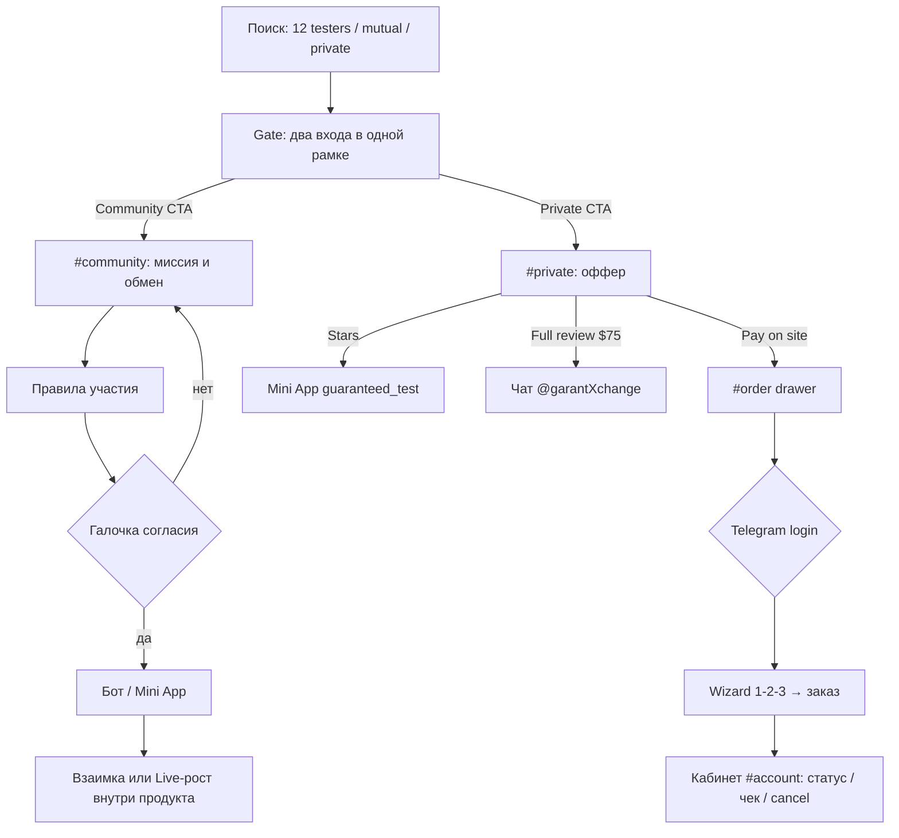

# DevTestHub website — устройство и развитие

Документ описывает **текущее** состояние публичного сайта
[https://devtesthub.app/](https://devtesthub.app/) на момент после редизайна
лица сообщества (ноябрь 2026). Цель: после прочтения можно менять тексты,
иерархию, CTA и коммерческие потоки, не ломая кабинет, заказ и авторизацию.

Краткая эксплуатационная шпаргалка остаётся в [README.md](README.md).
Особенности Telegram Login — в [AUTH_LOGIN_NOTES.md](AUTH_LOGIN_NOTES.md).

---

## 1. Место сайта в экосистеме

Сайт — **внешнее лицо** DevTestHub. Он не заменяет Mini App и бота.

| Канал | Роль |
| --- | --- |
| **Сайт** | Знакомство, выбор пути (сообщество / приватный тест), SEO, оформление приватного теста в браузере, кабинет заказов |
| **Telegram-бот** | Уведомления, базовые действия снаружи, вход в Mini App, оформление приватного теста (в т.ч. Stars) |
| **Mini App** | Основной продукт: взаимка, проекты, чекины, маркет, Live, репутация |
| **Backend API** | Авторизация сайта, commerce, заказы guaranteed/private test, профиль |

Сайт **статический**: HTML + CSS + JS, без сборки, без bundler, без framework,
без service worker. Хостинг — GitHub Pages. Секреты в репозиторий не кладутся.

Связь с остальным монорепо workspace: папка `devtest-web/devtest-web/` — это
отдельный Git-корень (свой `.git`, ветка `main`, CNAME `devtesthub.app`).
Backend и Mini App для сайта — **read-only references**, не часть этого деплоя.

---

## 2. Репозиторий, деплой, окружения

### 2.1. Публикация

- Git root: каталог с `index.html` и `CNAME`.
- Branch: `main`, folder `/`.
- `CNAME` = `devtesthub.app`.
- `.nojekyll` — отключает обработку Jekyll на Pages.
- `robots.txt` разрешает всё и указывает sitemap.
- `sitemap.xml` сейчас содержит только `https://devtesthub.app/`.

Локальный просмотр только по HTTP (не `file://`):

```sh
python -m http.server 5173 --bind 127.0.0.1
```

### 2.2. Окружения API / бота

Задаётся в `js/config.js` через `?env=prod|dev` и `sessionStorage` ключ
`dth.environment` (per-tab).

| ENV | API | Бот |
| --- | --- | --- |
| `prod` (по умолчанию) | `https://devtest-backend.onrender.com/api` | `Android12TestersBot` |
| `dev` | `https://dev-api.devtesthub.app/api` | `DevTestHub_bot` |

При `dev` на `<html>` ставится `data-env="dev"` → виден бейдж **DEV**
(ссылка на `?env=prod`). Смена окружения перезагружает страницу и сбрасывает
in-memory токен. Черновики заказов разделены по ENV и актору.

Произвольный override URL API **запрещён**. Временная политика main/dev/Phase-2
из project rules применяется к backend; сайт сам Phase-2 schema не обходит.

---

## 3. Информационная архитектура (лицо сайта)

Принцип: **самое важное на первом экране; дальше — только если человек пошёл
глубже.** Никакой декоративной «консоли» и маркетинговой воды.

### Миссия и принципы редакции

DevTestHub соединяет Android-разработчиков, которым нужен взгляд другого человека на своё приложение. Взаимный тест даёт первый повод поработать вместе. Ценность сохраняется после релиза, когда наблюдение участника помогает автору принять решение о следующей версии.

**Взаимность.** Обе стороны заранее понимают объём работы. Собственный допуск к публикации не завершает чужие тесты. На пути к вступлению называем срок, ежедневные действия и способ завершить обязательства.

**Польза автору.** Просим показать устройство, задачу, действие и результат. По хорошему отчёту можно повторить ошибку или решить, что изменить. После исправления у автора есть повод вернуться к тому же участнику за повторной проверкой.

**Свобода суждения.** Совпадение интересов может привести к покупке или постоянному использованию приложения. Участник сам решает, что рекомендовать и какую оценку поставить. Договорённость о взаимке касается тестирования и честного отклика.

**Доверие через наблюдаемые действия.** При описании числа указываем, кого или что оно считает, за какой период и где посмотреть источник. Участие в прошлом, текущая активность и готовность взять новый проект отвечают на разные вопросы. У личных показателей также разные основания: чекины, признание со стороны сообщества, подтверждённая ценность отчётов.

**Инициатива снизу.** Предложение может начать любой участник. Для первого разговора достаточно назвать людей, которым мешает проблема, предложить небольшой эксперимент и объяснить, по чему будет видно улучшение.

При проектировании нового экрана задаём три вопроса. Какое решение здесь принимает посетитель? Какой конкретный факт ему нужен сейчас? Куда он может перейти, если хочет узнать условия подробнее? Так миссия определяет текст кнопок, порядок раскрытия и работу продукта.

### 3.1. Карта экранов

На главной видно два маршрута. Более широкая карточка ведёт во взаимное тестирование, вторая — к услуге этой же команды. Ссылки под карточками открывают показатели сообщества и справочник.

| Ссылка | Что решает посетитель |
| --- | --- |
| `#top` | Выбрать взаимку или приватный тест |
| `#community` | Выбрать тему знакомства |
| `#community/mission` | Понять ценность реального теста и обратной связи |
| `#community/rules` | Принять обязательства и открыть бот или Mini App |
| `#community/published` | Подготовить сценарий для уже опубликованного приложения |
| `#trust` | Разобраться в географии, активности и трёх показателях профиля |
| `#build` | Выбрать направление развития и связаться с основателем |
| `#private` | Сравнить закрытый тест и письменный разбор, открыть заказ или Stars |
| `#faq` | Найти конкретный ответ о тесте, оплате или входе |

### 3.2. Навигация

Каждый адрес показывает одну секцию `main > [data-view]`. HTML содержит английский текст всех экранов. Hash-навигация на GitHub Pages поддерживает прямые ссылки и историю браузера без перезагрузки страницы. При переходе фокус перемещается на заголовок. Заказ, выбор языка и кабинет открываются поверх текущего экрана. На маленькой высоте или при увеличении шрифта содержимое можно прокрутить.

### 3.3. Внешние CTA (deeplink-контракт)

Ссылки проставляются в `js/app.js` по `data-bot-link`:

| `data-bot-link` | URL (prod) | Смысл |
| --- | --- | --- |
| `bot` / `mutual` | `https://t.me/{BOT}?start=web_mutual` | Вход в бота после согласия |
| `app` | `https://t.me/{BOT}/app` | Mini App (разместить / Live-рост) |
| `private` | `https://t.me/{BOT}/app?startapp=guaranteed_test` | Offer приватного теста в Mini App / Stars path |
| (support) | `SiteConfig.SUPPORT_URL` = `https://t.me/garantXchange` | Поддержка / разбор $75 / набор в команду |

Сайт **не** открывает Mini App через `WEBAPP_URL?dtview=…` — канон deeplink
через `t.me/.../app?startapp=…` (см. backend docs по private testing).

### 3.4. Галочка согласия сообщества

Файл: `js/landing.js`.

- Checkbox `#community-ack`.
- Пока не отмечен: `#community-actions` скрыт, виден `#community-wait`.
- После отметки: кнопки бота / Mini App; фокус на первую ссылку.
- Память: `localStorage` ключ `dth.community.ack.v2` = `"1"`.
- Это **клиентское** согласие для входа в сообщество, не серверная авторизация.
- Без JS: в `<noscript>` остаётся прямая ссылка на бота.

### 3.5. Что сознательно убрано / не делается на лендинге

- Интерактивный «Play Console dashboard» (бывший demo timeline).
- Bento «how it works», карточки тарифов как у SaaS, Phase-2 `$BUST` promo-блок
  на главной, финальный CTA «Launch private test» внизу.
- Публичный live trust-counter: API публичной статистики на сайте нет; метрики
  описаны словами, живые числа — в профиле Mini App.
- Отдельная страница маркета: маркет упомянут как направление в разработке
  внутри `#build`, не как продукт сайта.
- Checkout для $75 review: отдельного order type нет → только чат.

---

## 4. Визуальная система

### 4.1. Слои CSS (порядок важен)

1. `css/styles.css` — базовые примитивы: кнопки, формы, header/footer, wizard
   controls, старые layout-хелперы, mobile breakpoints для checkout.
2. `css/redesign.css` — тёмная product-shell палитра, drawers, header chip,
   account/order UI, responsive оболочки.
3. `css/face.css` — главная, навигация между экранами, списки разделов и оформление материалов.

Палитра (redesign / face):

| Токен | Пример | Роль |
| --- | --- | --- |
| `--bg` | `#040814` | фон страницы |
| `--surface` / raised | `#0b1224` / `#111c33` | карточки, doors |
| `--text` | `#f6f8ff` | основной текст |
| `--muted` | `#93a2bc` | вторичный текст |
| `--accent` / blue | `#3b82f6` / `#4ea8ff` | primary CTA, акценты |
| `--green` | `#86d9b5` | статусы готовности в кабинете |

Бренд-марка: четырёхлепестковый SVG inline в header/footer/login; favicon и
social card в `assets/`.

Типографика: системный стек из `styles.css` (без отдельного webfont).
Крупный H1 обозначает текущий экран. Длинный текст ограничен по ширине; второстепенные коммерческие и командные подробности раскрываются по запросу.

На широких экранах маршруты располагаются рядом, на телефоне — друг под другом. Высота главной учитывает шапку и доступную высоту окна.

Drawers:

- Desktop: правый slide-over.
- Mobile: account/order на почти полный экран снизу; language — bottom sheet.
- Один диалог за раз; `page-shell` становится `inert`; focus trap; Escape /
  backdrop / close; `prefers-reduced-motion`.

---

## 5. Модули JavaScript

Все скрипты — IIFE, глобалы `window.Site*`. Порядок в `index.html` (упрощённо):

```
config.js          → SiteConfig (sync, до defer-логики)
utils.js           → SiteUtils
languages.js       → SiteLanguages
site-copy.js       → SiteCopy EN/RU
faq-copy.js        → FaqCopy EN/RU
i18n.js            → SiteI18n
drawers.js         → SiteDrawers
api.js             → SiteAPI
wizard.js          → SiteWizard
app.js             → SiteApp (auth UI, me, commerce, bot links)
landing.js         → chapter navigation + community ack
```

| Модуль | Ответственность |
| --- | --- |
| `config.js` | ENV, API_BASE, BOT, support, group email, PayPal |
| `utils.js` | packageId / normalizeLink (строгий Play host), exchanges UID, receipt validation, orderDay, protect() от Google Translate |
| `api.js` | Bearer в closure, login, call, mixed-auth reject, timeout 45s, stale generation |
| `drawers.js` | open/close, hash history, focus, Escape |
| `wizard.js` | 3 шага заказа, draft, commerce prices, submit/requisites/attach-proof |
| `app.js` | Telegram Widget, `/web/me`, orders/projects UI, multi-profile switcher, bot link wiring |
| `landing.js` | навигация по экранам и подтверждение правил |
| `i18n.js` | native EN/RU + Google Translate для каталога 56 языков |
| `site-copy.js` / `faq-copy.js` | продуктовые строки лица и FAQ |

Правило масштабирования: **лицо сайта** расширять через `face.css` + разметка
в `index.html` + ключи в `site-copy.js`. Checkout/auth — через `wizard.js` /
`app.js` / `styles.css`+`redesign.css`, не смешивая с face.

---

## 6. Авторизация и кабинет

### 6.1. Telegram Login Widget

- Официальный iframe `telegram-widget.js?22`, `data-onauth`, write permission.
- Callback **без изменений** → `POST /web/auth/telegram`.
- Ответ: `access_token` + `expires_in` (сайт clamp ≤ 3600s).
- Токен **только в памяти** `SiteAPI` (не localStorage / cookie / URL).
- Private routes: только `Authorization: Bearer …`, `credentials: 'omit'`.
- Наличие `init_data` в body/FormData → `ambiguous_authentication` до fetch.

После успеха: `GET /web/me`, обновление chip в хедере, открытие account drawer.

Ошибки 404/503/401/network → тёмный toast с ENV и retry. Детали phone prompt /
Xiaomi / clones: `AUTH_LOGIN_NOTES.md`.

### 6.2. Профиль и мультиаккаунт

`GET /web/me` → `profile`, `active_orders`, `projects`, balance ($BUST
информационно).

Профили для переключения и их токены живут в памяти вкладки до окончания сессии. После перезагрузки требуется повторный вход. При первом открытии новой версии удаляется старый локальный кеш токенов.

Опционально для `in_progress` без `started_at` в compact me: доп. запрос
`GET /guaranteed-test-orders/mine`, пересечение по своим ID / user_id, только
чтение дат старта. `Day X / 15` считается только из валидной реальной даты
(`SiteUtils.orderDay`), без фабрикации прогресса.

### 6.3. Кабинет UI

- Sign out / refresh.
- Список заказов: статус, код, resume unpaid (чек), cancel unpaid, support link.
- Projects: кнопка «Order private testing» → `SiteWizard.prefill` + open order.
- Ссылка на бота для чеков/статуса.

---

## 7. Коммерция: приватное тестирование

### 7.1. Цены и discovery

При загрузке: `GET /web/commerce` (без auth).

Ожидается блок `private_testing` с `currency: USD` и ценами
`crypto` / `paypal` / `bank`. Если сервис выключен или цены невалидны —
checkout fail-closed (кнопки/сабмит не «придумывают» сумму).

Дефолт на UI до ответа: `$20` crypto, `$23` paypal/bank. Элементы
`[data-price="crypto|paypal|bank"]` обновляются из commerce.

PayPal.me зафиксирован на `$23`; если commerce отдаёт другую paypal-цену,
прямая ссылка скрывается, остаётся manual PayPal email.

### 7.2. Wizard (3 шага)

1. **App details** — имя, free/paid, License Testing для paid (+ гайды).
2. **Play Console** — testing link / package (нормализация), чек-лист группы /
   стран / review, скриншоты гайдов.
3. **Payment** — crypto (exchange UID) / PayPal / bank (requisites → менеджер
   `@garantXchange` → attach proof).

Группа тестировщиков: `google-play-dev-test@googlegroups.com`
(`SiteConfig.GROUP_EMAIL`).

Receipt: PNG/JPEG/WebP ≤ 5 MB → `POST /upload-icon` multipart
`upload_kind=payment_proof` → URL в notes / `proof_url`.

Создание заказа:

- Crypto/PayPal: `POST /guaranteed-test-orders`, `create_mode=submit`.
- Bank: `create_mode=requisites` → после оплаты `/{id}/attach-proof`.
- Cancel unpaid: `POST .../cancel`.

Сабмит **не** ретраится автоматически после timeout (заказ мог уже создаться).

### 7.3. Черновик заказа

Ключ: `dth.draft.v1.<prod|dev>.<guest|telegramId>`.

Хранит поля формы и `fiatOrderId`, **не** байты чека, не token, не proof URL.
Закрытие drawer не чистит draft и не отменяет заказ. Чужой actor draft не
наследует. 401 сохраняет draft актора, чистит private UI, открывает sign-in.

### 7.4. Stars и $75

- **Stars:** CTA на сайте ведёт в Mini App `startapp=guaranteed_test` — оплата
  Stars живёт в боте/Mini App, не в website wizard.
- **$75 Full review:** продуктовое предложение на лице; оформления через
  website API нет → CTA в support chat.

---

## 8. Интернационализация

1. Статический HTML — английский (SEO source).
2. Native RU — словари в `i18n.js` + override `SiteCopy` / `FaqCopy`.
3. Остальные языки — скрытый Google Translate Element + cookie `googtrans`,
   каталог `languages.js` (56 языков, локальные SVG-флаги в `assets/flags/`).
4. RTL для `ar`, `fa`, `he`, `ur`.
5. `SiteUtils.protect()` / `notranslate` — бренд, UID, email, package, суммы,
   form inputs, order codes не должны ломаться машинным переводом.
6. API-строки — через `textContent` / native `Option`, не HTML-интерполяцию
   ответов сервера.

Ключи лица сообщества (gate / sheet / build / private offers) живут в
`js/site-copy.js`. Меняя смысл — обновлять EN и RU вместе и статический EN в
`index.html` (чтобы краулер и первый paint совпадали).

Язык UI: `localStorage` `dth.language`.

---

## 9. SEO и структурированные данные

В `index.html`:

- `<title>`, meta description, canonical, Open Graph, Twitter card.
- JSON-LD `Service` + offers ($20 / $23 / $75).
- JSON-LD `FAQPage` — 10 вопросов; текст FAQ должен совпадать с видимыми
  `seoFaqNq` / `seoFaqNa` (проверяется тестом).

FAQ открывается на экране `#faq`, но **остаётся в HTML-источнике** —
не инжектится только JS.

Социальная картинка: `assets/social-card.png` (+ svg). Растр на Windows:
`tests/render-social.ps1`.

---

## 10. Хранилище браузера (сводка ключей)

| Ключ | Где | Что |
| --- | --- | --- |
| `dth.environment` | sessionStorage | `prod` / `dev` |
| `dth.language` | localStorage | код языка UI |
| `dth.community.ack.v2` | localStorage | согласие лица сообщества |
| `dth.draft.v1.<env>.<actor>` | localStorage | черновик wizard |
| Bearer token | **только RAM** | до expires_in ≤ 1h |

---

## 11. Тесты и QA

```sh
node --test tests/core.test.cjs
```

Покрывает: ENV selection, package identity, API bearer/mixed-auth/stale session,
SEO/CNAME/local assets, orderDay, language catalog/flags.

Браузерный harness: `tests/qa.html` + `runner.js` + `mock.js` — iframe с
моками API/Widget/storage; без реальных платежей. `noindex`. Hash/history
лучше проверять на top-level local app.

Артефакты скринов: `artifacts/`, `artifacts/redesign/`.

---

## 12. Как развивать сайт (практические правила)

### 12.1. Менять смыслы / лицо

1. Править разметку секций в `index.html` (EN source остаётся читаемым).
2. Добавить/обновить ключи в `js/site-copy.js` (EN + RU).
3. Стили лица — только `css/face.css`.
4. Новые deeplink’и — через `data-bot-link` + таблицу в `app.js`, не хардкодить
   username бота в HTML (кроме fallback href до JS).
5. Обновить JSON-LD / meta, если меняются офферы или позиционирование.
6. Прогнать `node --test tests/core.test.cjs`.
7. Обновить этот документ, если меняется IA или контракт.

### 12.2. Добавлять коммерческий продукт

- Если есть backend order type → расширять `wizard.js` + commerce contract +
  account list; не рисовать «оплату» без API.
- Если продукта в API ещё нет (как $75 review) → тихий CTA в чат / заглушка,
  без фейкового checkout.

### 12.3. Live trust / публичная статистика

Сейчас посетитель может сверить релизы, чекины за 30 дней, ошибки и предложения в публичном Daily Digest. Источник — блок PLATFORM SNAPSHOT, который формирует `_format_digest_post` в backend. География доступна в Mini App. Для отображения чисел прямо на сайте нужен **публичный** endpoint (без PII), затем блок на gate или sheet,
который fail-closed при ошибке и явно маркирует «live». Не подставлять
декоративные цифры.

### 12.4. Новые разделы

Добавьте статическую секцию с `data-view`, уникальный id, h1, ссылку на родительский раздел и вход из соответствующего меню. Добавьте русский перевод новых ключей. Для новой редакции обязательств пересмотрите версию ключа подтверждения.

### 12.5. Маркет приложений

На сайте — только упоминание в `#build`. Полноценный маркет живёт в Mini App.
Вынос на web потребует auth + API витрины и отдельного UX; не смешивать с gate.

### 12.6. Чего не делать

- Не класть secrets / service keys в сайт.
- Не писать токен в storage «для удобства» без явного security review.
- Не смешивать `init_data` Mini App с Bearer сайта.
- Не обещать автоматический production access от Google.
- Не чинить Phase-2 staging-несовместимости костылями на сайте.
- Не раздувать первый экран второстепенными блоками.

---

## 13. Диаграмма потоков пользователя



---

## 14. Карта файлов (канон)

```
index.html              лицо + drawers + FAQ + JSON-LD
css/styles.css          база / формы / wizard primitives
css/redesign.css        shell, drawers, account
css/face.css            публичное лицо (gate/sheets)
js/config.js            ENV + endpoints
js/utils.js             identity, receipts, protect, orderDay
js/api.js               session + fetch
js/drawers.js           modal lifecycle
js/wizard.js            private-test checkout
js/app.js               auth UI, me, bot links, commerce load
js/landing.js           chapter navigation + community ack
js/i18n.js              translations engine
js/site-copy.js         EN/RU product face copy
js/faq-copy.js          FAQ RU overrides / extras
js/languages.js         56-language catalog
assets/…                brand, flags, Play Console guides
tests/…                 node + browser harness
SITE_ARCHITECTURE.md    этот документ
README.md               ops cheat sheet
AUTH_LOGIN_NOTES.md     Telegram Widget quirks
```

---

## 15. Известные ограничения на сейчас

- Публичного live trust API на сайте нет.
- `$BUST` на сайте — баланс в кабинете / Phase-2 capability, без website top-up.
- Stars и часть UX приватного теста канонично живут в Mini App.
- `$75` review не оформляется заказом на сайте.
- Локальный `file://` и localhost Widget могут давать `Bot domain invalid` —
  реальный login тестировать на авторизованном домене BotFather.


При сомнении: поведение кода в `index.html` + `js/*` важнее маркетинговых
формулировок. Меняя продукт — обновляйте этот файл в том же изменении.
